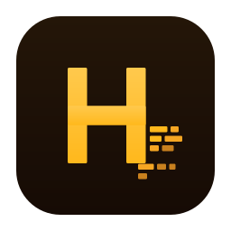

# Hush

**Local voice-to-text and meeting transcription.**
macOS, Linux, and Windows. Free. Open source. No account. No cloud.

Dictate anywhere with a hotkey. Capture meetings with mic + system audio in parallel (macOS). Label You vs Remote.

[Download](https://github.com/khawkins98/Hush/releases) · [Privacy](#privacy-grep-the-source) · [Engineering](#engineering) · [Contribute](./CONTRIBUTING.md)

---

## Why I made it

This started as a hobby project. I wanted transcripts of my work calls, but I never liked recording my colleagues just to get them — I needed the words, not a sound file of everyone that outlives the meeting. I'd also gotten hooked on a push-to-talk dictation hotkey and didn't want to give it up. What nagged at me was keeping two separate tools for that: one for dictation, one for meetings. I wanted a single app that did both, kept everything on my machine, and left no recording behind.

So I wanted to see how far I could get building it myself. Hush is what I came up with.

## What it is

- **Dictation:** hold a hotkey, speak and release. The transcript is copied to your clipboard. Defaults are `Right ⌘` on macOS and `Right Ctrl` on Linux/Windows.
- **Meetings:** record mic and system audio in parallel on macOS, with **You / Remote** labels or optional local speaker diarisation. Meeting-app detection can start capture automatically; turn it off in Settings. Linux and Windows use mic-only meeting capture.
- **One local history:** dictation and meetings share a model load and searchable transcripts.

## Install

Download an installer from [Releases](https://github.com/khawkins98/Hush/releases): `.dmg` for macOS, `.AppImage` or `.deb` for Linux, `.msi` or `.exe` for Windows.

On macOS, open the DMG and drag **Hush.app** to Applications. The app is unsigned, so first launch can show a Gatekeeper warning. Windows can show SmartScreen. Follow [Getting started](docs/getting-started.md) for the one-time bypass, permissions, model download and your first dictation or meeting. [macOS permission troubleshooting](docs/macos-permissions.md) covers grants that stop working after updates.

Hush does not auto-update. Check **Settings → About → Check for updates**, or the **Hush** menu on macOS. Code-signing support is [sponsorable](https://github.com/sponsors/khawkins98).

## Platform support

**macOS 26 is the primary, hands-on-tested target.** Linux and Windows build and test in CI but are not hands-on tested. Their meeting mode is mic-only; on Wayland, use the toggle hotkey instead of push-to-talk. Please [report platform issues](https://github.com/khawkins98/Hush/issues/new) with your version and reproduction steps.

## Privacy: grep the source

Transcription runs locally once the required models are downloaded. Captured audio is processed in RAM rather than saved as a recording; transcripts and history stay on your machine. Hush has no telemetry, analytics, crash reporter or startup beacon.

Model downloads and manual update checks use the network. See [Privacy and network behavior](docs/privacy.md) for download verification, endpoints and source locations.

## How it compares

Hush combines hotkey dictation and meeting capture in one local app. The [comparison survey](docs/comparison.md) preserves the **2026-07-28 snapshot**, including its free/open-source distinctions and platform caveats; it is not a current price list.

## Engineering

Hush uses Rust, Tauri and Svelte, with trait-based OS boundaries and mocks for deterministic IPC tests. [Architecture](ARCHITECTURE.md) explains the windows, runtime and module map; [learnings](learnings.md) records decisions, including rejected approaches.

## Documentation

- [Install and make a first recording](docs/getting-started.md); [fix macOS permissions](docs/macos-permissions.md).
- [Run or build Hush locally](docs/developing.md); [contribute](CONTRIBUTING.md); [agent guidance](CLAUDE.md).
- [See current status](STATUS.md), [release changes](CHANGELOG.md) or [report a vulnerability](SECURITY.md).

## Acknowledgements

Hush was inspired by [VoiceInk](https://github.com/Beingpax/VoiceInk) by [Pax](https://github.com/Beingpax). Public documentation from [Detto](https://github.com/Gremble-io/Detto) by [Jason Craik](https://github.com/Gremble-io) also informed design decisions. No VoiceInk or Detto source code was read or used.

The [full acknowledgements](docs/acknowledgements.md) preserve the specific contributions, GrembleVoice credit, source-use discipline and license distinctions. Contributors must follow the [black-box reimplementation rules](CONTRIBUTING.md).

## License

Apache 2.0 — see [LICENSE](LICENSE).
